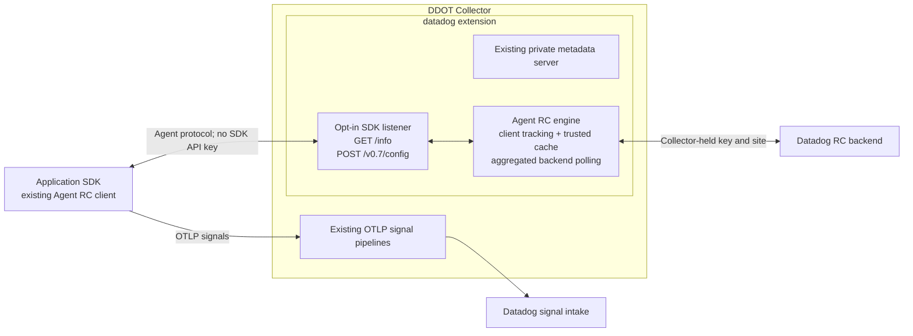

# Datadog extension: optional Remote Configuration

Development prototype for DDOT. Adds an opt-in `remote_config` capability to the existing contrib **Datadog extension**, without another customer-facing extension type or a Datadog Agent process.

## Motivation

Customers routing OTLP signals through a Collector also need SDK configuration. A transparent RC forwarder reuses the agentless clients available in Python and Node.js, but every SDK still polls Datadog independently. Java does not have the same supported agentless DI path and cannot reuse libdatadog.

This alternative hosts the existing Agent RC engine in the Collector. SDKs use their Agent RC clients; the Collector supplies credentials, tracks clients, caches trusted configuration and aggregates backend polling. It can avoid implementing a new Java agentless RC client. Supported endpoint selection and real backend qualification remain work.

## Architecture



The SDK listener is separate from the metadata server. With RC disabled, the factory returns the original upstream extension instance. With RC enabled, a wrapper delegates metadata snapshots, pipeline/status notifications and serializer access, and owns the RC listener/service lifecycle. Startup rolls back metadata services if RC cannot start.

The internal service reuses the Agent engine rather than translating each SDK request to an agentless backend request. It retains targeting, trusted caching, signature/expiry handling and rate-limited cold-client refreshes. SDKs continue to decode and apply their configuration.

## Configuration

Requires this custom DDOT build. This block is **not supported by the stock OSS extension**.

```yaml
extensions:
  datadog:
    api:
      key: ${env:DD_API_KEY}
      site: ${env:DD_SITE}
    remote_config:
      enabled: true
      endpoint: 127.0.0.1:8234
      cache_directory: /var/lib/datadog/remote-config

receivers: ...
processors: ...
exporters: ...
service:
  extensions: [datadog, ...]
  pipelines: ...
```

| Setting | Prototype behavior |
| --- | --- |
| `remote_config.enabled` | Defaults to false. No RC listener, cache or poller when disabled. |
| `endpoint` | Defaults to `127.0.0.1:8234`; only `/info` and `/v0.7/config` are served. |
| `cache_directory` | Required absolute writable directory when enabled. Instances use separate private subdirectories. |
| `refresh_interval` | Defaults to one minute. SDK polls remain separate; cold clients can trigger bounded cache-bypass refreshes. |
| `request_timeout` | Defaults to five seconds; the HTTP boundary returns 503 on timeout even if an engine wait ignores cancellation. Backend requests have ten-second deadlines and shutdown cancellation. |
| Listener TLS/authentication | Standard Collector HTTP server settings inside `remote_config`. Configure for remote workloads. |

Only top-level `api.key` and `api.site` supply RC credentials; a second `remote_config.api` block is rejected. The wrapper builds an isolated Agent config adapter from those resolved values, so unrelated Agent environment credentials do not override them. Upstream keeps its own adapter private: sharing the actual adapter and live key rotation requires an upstream service hook. This prototype reloads credentials by component restart.

Backend requests use the Agent HTTP transport, system TLS trust and the configured proxy. RC explicitly rejects custom top-level backend TLS/auth/middleware/header settings instead of silently ignoring them. Complete Collector transport integration is pre-GA work. Redirects are disabled for RC, preserving credentials at the configured origin, and idle backend connections are released on shutdown.

Loopback works only in a shared network namespace. Separate pods need a reachable node-local listener, TLS trust and workload access controls. Do not expose the metadata server to SDK workloads. DDOT's separate `ddflare` extension is unchanged.

## SDK and DI boundaries

- **Python and Node.js:** existing agentless RC/DI capabilities are the foundation of the separate forwarding design. This component instead serves their Agent RC protocol; selecting that transport while retaining OTLP export needs qualification.
- **Java:** existing Agent RC can use this listener without a new libdatadog integration. A released Java 1.68.1 protocol smoke test exercises the internal adapter without an SDK key when its jar is supplied. It does not establish real backend application, supported onboarding or complete product support.
- **DI is separate:** RC delivers probe definitions and configuration acknowledgements. This prototype does not provide snapshot, diagnostic or symbol upload routes. Java DI needs compatible discovery and Agent-facing DI forwarding in addition to RC. Ordinary OTLP log receipt is not DI product recognition.

The Agent RC protocol is JSON `/v0.7/config`; the agentless protobuf protocol uses different endpoints. Migration requires explicit SDK transport selection, not changing an agentless URL to this listener.

## Validation and remaining work

Tests cover opt-in behavior, shared resolved credentials, config decoding, listener separation, metadata capability delegation, startup rollback, shutdown, Agent JSON fidelity, client identity normalization, request limits, error redaction and cancellation of a stalled real Agent RC service. A synthetic redirect test verifies that the RC API client does not forward the key to a redirect target.

Before promoting this prototype:

1. Validate two independently targeted SDK clients and measure shared backend polling, including cold starts and cache bypasses. Existing Agent engine tests exercise the reused engine; adapter tests alone do not establish multi-client load behavior.
2. Verify Java RC updates/removals against staging without an SDK API key or direct backend egress, while preserving OTLP signal export. Define public endpoint onboarding and Collector backend identity/entitlements.
3. Complete transport integration, workload authentication, credential rotation, cache ownership, bounded client admission, expiry/outage/restart tests and RC metrics/status. Node-local deployment or stable affinity avoids unnecessary replica churn.
4. Qualify DI separately with real probes, diagnostics, symbols and a recognized product result. Reuse/extract Agent-compatible DI proxy behavior; do not invent cross-process batching of opaque JSON or multipart bodies.
5. Update DDOT/OSS onboarding and Kube Stack injection. Start DDOT-first, then seek integration into existing contrib `datadogextension` after GA, with dependency extraction and maintainer review.

Bundling simplifies onboarding. It does not remove the RC implementation and operational work. This draft explores that choice; it does not replace the validated HTTP-forwarder demo.
