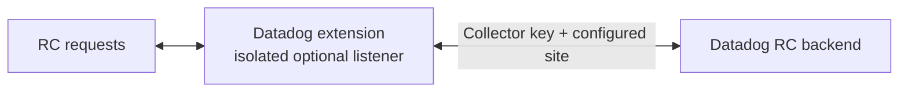

# Datadog extension: Remote Configuration forwarding

Prototype factory for custom Collector distributions. It adds an optional RC HTTP listener to the existing Datadog extension. **Default DDOT registration is not included**; distribution integration belongs in a future PR.

## Design



The listener forwards opaque RC requests to `config.<api.site>`, using the extension's `api.key`. It is separate from the private metadata server and disabled by default. Forwarding is stateless: no configuration cache or aggregated backend polling is provided.

The implementation uses Collector HTTP client/server helpers, restricts routes and methods, replaces incoming credentials, disables redirects, and bounds request size and duration. Its lifecycle covers startup rollback, request cancellation and listener shutdown. Explicit idle-pool cleanup remains an HTTP-helper integration follow-up.

## Configuration

This example requires a custom distribution using `NewFactory(upstream.NewFactory())`; it does not work in the default DDOT or OSS distribution.

```yaml
extensions:
  datadog:
    api:
      key: ${env:DD_API_KEY}
      site: ${env:DD_SITE}
    remote_config:
      enabled: true
      endpoint: 127.0.0.1:8234

receivers: ...
processors: ...
exporters: ...
service:
  extensions: [datadog, ...]
  pipelines: ...
```

Standard Collector HTTP listener TLS/authentication settings fit under `remote_config`. Backend transport uses the existing extension's HTTP settings. Only top-level API settings supply credentials and site routing.

## Follow-up

Register the factory in a distribution, document onboarding, and qualify authentication, credential updates and backend load before shipping.
