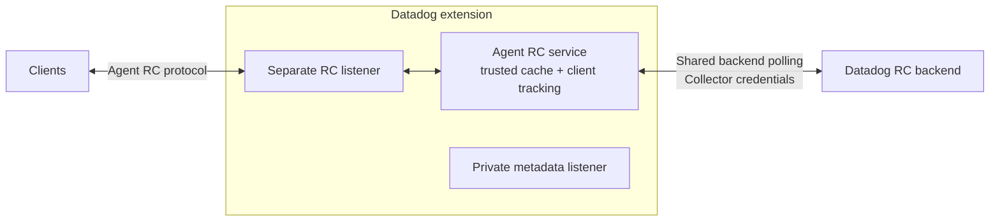

# Datadog extension: Remote Configuration

Prototype factory that adds optional Remote Configuration (RC) to the existing Datadog extension by directly reusing the Agent RC service. No separate Datadog Agent process is required.

## Design



The factory preserves the existing metadata lifecycle and owns a separate RC listener and service. Top-level API-key/site settings supply backend authentication and routing. Collector HTTP settings, instrumentation and component status handle transport and lifecycle integration.

The shared Agent HTTP API only provides client injection. Redirect policy and connection cleanup belong to the extension.

## Configuration

Requires a custom Collector build using `NewFactory(upstream.NewFactory())`. This factory is **not registered in default DDOT distributions**; distribution integration is deferred.

```yaml
extensions:
  datadog:
    api:
      key: ${env:DD_API_KEY}
      site: ${env:DD_SITE}
    remote_config:
      enabled: true
      endpoint: 127.0.0.1:8234
      cache_directory: /var/lib/datadog/remote-config

receivers: ...
processors: ...
exporters: ...
service:
  extensions: [datadog, ...]
  pipelines: ...
```

RC defaults to disabled. The cache directory must be absolute and writable. Keep the metadata listener private; use listener TLS/authentication for access beyond the local host. Backend TLS verification is required, redirects are disabled, and credentials currently reload by component restart.

## Remaining work

- Add distribution registration, packaging and onboarding documentation in a follow-up PR.
- Qualify multi-client polling, cache recovery, load and credential rotation.
