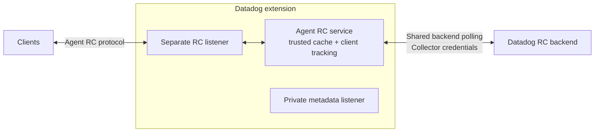

# Datadog extension: Remote Configuration

This prototype adds optional Remote Configuration (RC) to the DDOT Datadog extension by directly reusing the Agent RC service. No separate Datadog Agent process is required.

## Design



The factory preserves the existing metadata lifecycle and owns a separate RC listener and service. Top-level API-key/site settings supply backend authentication and routing. Collector HTTP settings, instrumentation and component status handle transport and lifecycle integration.

The shared Agent HTTP API only provides client injection. Redirect policy and connection cleanup belong to the extension.

## Configuration

The RC-capable factory is registered in DDOT builds from this branch. Enable it through the existing `datadog` extension; RC stays disabled unless `remote_config.enabled` is true.

```yaml
extensions:
  datadog:
    api:
      key: ${env:DD_API_KEY}
      site: ${env:DD_SITE}
    remote_config:
      enabled: true
      endpoint: 127.0.0.1:8234
      cache_directory: /var/lib/datadog/remote-config

receivers: ...
processors: ...
exporters: ...
service:
  extensions: [datadog, ...]
  pipelines: ...
```

RC defaults to disabled. The cache directory must be absolute and writable. Keep the metadata listener private; use listener TLS/authentication for access beyond the local host. Backend TLS verification is required, redirects are disabled, and credentials currently reload by component restart.

## Build and run for testing

```sh
dda inv otel-agent.build
DD_OTEL_STANDALONE=true DD_OTELCOLLECTOR_ENABLED=true ./bin/otel-agent/otel-agent run --config=file:/absolute/path/otel-config.yaml
```

Use an existing Collector configuration with the extension block above and a writable absolute cache directory. The normal DDOT binary and its packaging build include the factory; no custom factory registration is needed. Custom distributions can still use `NewFactory(upstream.NewFactory())`.

## Remaining work

- Preserve backend-controlled polling when no refresh interval is configured.
- Complete deployment, larger-scale and credential-rotation qualification.
