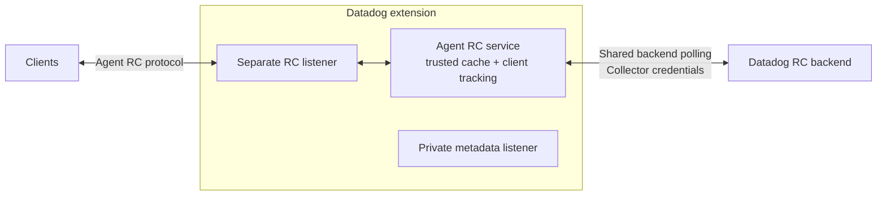

# Datadog extension: Remote Configuration

This prototype adds optional Remote Configuration (RC) to the DDOT Datadog extension by directly reusing the Agent RC service. No separate Datadog Agent process is required.

## Design



The factory preserves the existing metadata lifecycle and owns a separate RC listener and service. Top-level API-key/site settings supply backend authentication and routing. Collector HTTP settings, instrumentation and component status handle transport and lifecycle integration.

The shared Agent HTTP API only provides client injection. Redirect policy and connection cleanup belong to the extension.

## Configuration

The RC-capable factory is registered in DDOT builds from this branch. Enable it through the existing `datadog` extension; RC stays disabled unless `remote_config.enabled` is true.

```yaml
extensions:
  datadog:
    api:
      key: ${env:DD_API_KEY}
      site: ${env:DD_SITE}
    remote_config:
      enabled: true
      endpoint: 127.0.0.1:8234
      cache_directory: /var/lib/datadog/remote-config

receivers: ...
processors: ...
exporters: ...
service:
  extensions: [datadog, ...]
  pipelines: ...
```

RC defaults to disabled. The cache directory must be absolute and writable. Keep the metadata listener private; use listener TLS/authentication for access beyond the local host. Backend TLS verification is required, redirects are disabled, and credentials currently reload by component restart.

## Build and run for testing

```sh
dda inv otel-agent.build
DD_OTEL_STANDALONE=true DD_OTELCOLLECTOR_ENABLED=true ./bin/otel-agent/otel-agent run --config=file:/absolute/path/otel-config.yaml
```

Use an existing Collector configuration with the extension block above and a writable absolute cache directory. The normal DDOT binary and its packaging build include the factory; no custom factory registration is needed. Custom distributions can still use `NewFactory(upstream.NewFactory())`.

## Remaining work

- Preserve backend-controlled polling when no refresh interval is configured.
- Complete deployment, larger-scale and credential-rotation qualification.

## Experimental DI events

This draft also prototypes DI output over standard OTLP. SDK probe definitions
continue through RC; metric probes and dynamic spans use the normal metrics and
traces pipelines. Snapshots, probe messages, diagnostics and symbols use named
OTel events carried over OTLP Logs.

Enable `dynamic_instrumentation.enabled: true` in the extension and route the
OTLP logs pipeline through this branch's `datadog` exporter. The flag defaults
to false. The exporter separates DI events before ordinary log mapping and
calls the extension, which owns credentials and sends to debugger intake.
Ordinary application logs may arrive through `file_log` in the same pipeline.
Do not fan the DI pipeline out to an ordinary logs or debug exporter.

The POC scope is `com.datadoghq.dynamic_instrumentation`; event names are
`dd.debugger.snapshot`, `dd.debugger.log`, `dd.debugger.diagnostic` and
`dd.debugger.symbols`. Each carries integer `datadog.di.schema_version: 1`, a
lossless JSON string in `datadog.di.payload`, and `datadog.di.tags`. The extension
reconstructs the existing intake payloads, including diagnostic multipart and
compressed symbol attachments. Unknown DI names/versions and disabled delivery
return errors without falling back to ordinary log indexing.

**Product isolation is still blocked.** The live POC delivered a real RC probe
and captured output, but a capture also appeared through the Logs search API.
The existing debugger backend can forward snapshots into the logs track;
Collector routing alone cannot prevent it. This draft is transport feasibility
work, not a solution to debugger-only storage and querying. That backend
contract must be resolved before this mode can satisfy the requirement that DI
events never appear in Datadog Logs.

The initial scope is single-process HTTP/protobuf with Python. Backpressure,
partial-batch retries, batching performance, resource limits, endpoint/platform
qualification and full product onboarding remain follow-ups. Retrying a mixed
batch can duplicate records already accepted by one destination. The adapter
does not own a persistent retry queue.
