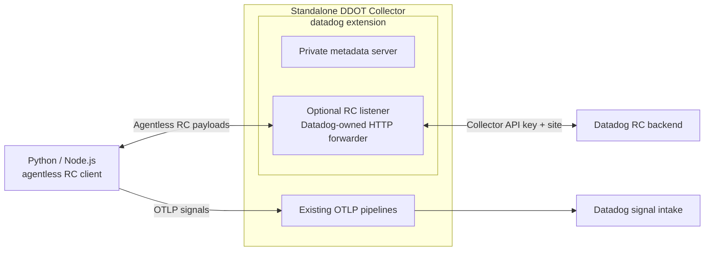

# Datadog extension: agentless Remote Configuration forwarding

Development prototype for DDOT. Adds an opt-in `remote_config` listener to the existing **Datadog extension**, using a small Datadog-owned HTTP forwarder. No separate extension type or Datadog Agent process is required.

## Motivation

Python and Node.js already have agentless RC clients developed alongside agentless Dynamic Instrumentation. This design lets those clients use a Collector for RC authentication and routing, while ordinary OTLP signals use the existing Collector pipelines. Java needs a separate agentless RC workstream and cannot reuse libdatadog.

The forwarder preserves SDK requests and backend responses. It supplies the Datadog API key from the Collector and selects `config.<api.site>`. It does not run the Agent RC engine, cache configuration or aggregate SDK polling. [Draft #60194](https://github.com/DataDog/datadog-agent/pull/60194) explores that independent Agent-protocol design.

## Architecture



The SDK listener is separate from the metadata server. With RC disabled, DDOT returns the original upstream extension. When enabled, its wrapper preserves metadata snapshots, pipeline/status notifications and serializer access, and owns listener startup, rollback and shutdown.

## Configuration

Requires this custom DDOT build. Released OSS/DDOT binaries do not accept this block. Ellipses omit unrelated signal configuration.

```yaml
extensions:
  datadog:
    api:
      key: ${env:DD_API_KEY}
      site: ${env:DD_SITE}
    remote_config:
      enabled: true
      endpoint: 127.0.0.1:8234
      request_timeout: 10s

receivers: ...
processors: ...
exporters: ...
service:
  extensions: [datadog, ...]
  pipelines: ...
```

Only top-level `api.key` and `api.site` configure backend credentials and routing. A second `remote_config.api` is rejected. RC defaults to disabled. Its listener defaults to loopback and accepts only `GET /api/v0.1/org` and `POST /api/v0.1/configurations`; queries, other routes and methods are rejected. Requests are limited to 1 MiB by default.

The listener accepts standard Collector HTTP server TLS/authentication settings under `remote_config`. Outbound requests reuse the existing extension's Collector HTTP client settings, including TLS/proxy support. Redirects are returned without being followed. SDK credentials, cookies, unrelated workload headers and hop-by-hop headers are removed; content negotiation/encoding and SDK metadata are retained. The outgoing request receives exactly one configured Datadog API-key header. Backend errors are redacted, and response status, binary payloads, compression and repeated headers are preserved.

Loopback applies only to a shared network namespace. Separate pods require a reachable listener, TLS trust and workload authentication. Keep the metadata listener private. Credentials are updated through Collector component restart. Shutdown cancels active backend requests and closes the listener. Explicit idle-pool cleanup remains an upstream HTTP-helper integration gap: instrumentation wrappers do not expose the underlying transport cleanup method.

## SDK boundaries

- **Python and Node.js:** point their agentless RC transport at the Collector origin. The libdatadog client derives the two backend paths from that origin. Supported endpoint settings and onboarding need SDK release review.
- **Python POC:** its existing local wheel still requires a 32-zero placeholder key to initialize agentless mode. The real key is held only by the Collector. Removing the SDK initialization requirement remains shipping work; the placeholder does not establish fully keyless SDK initialization.
- **Java:** this design needs an agentless RC client and supported endpoint configuration. Java cannot reuse libdatadog. The independent Agent RC design can instead reuse Java's existing Agent protocol.
- **DI:** RC can deliver configuration, but this component has no DI snapshot, diagnostic or symbol upload routes. DI delivery remains a separate follow-up.

## Validation and remaining work

Tests cover Collector config decoding and recursive validation, opt-in defaults, metadata delegation, startup rollback, protobuf byte preservation, authentication replacement, header filtering, redirect rejection, gzip response preservation, invalid requests, body limits, error redaction and shutdown cancellation.

Before shipping:

1. Validate live RC updates, acknowledgements and removal using Python and Node.js while preserving OTLP export. Keep SDK initialization/endpoint changes explicit.
2. Agree backend load limits: each SDK still polls the backend independently. Connection reuse does not provide aggregation.
3. Qualify workload authentication, transport settings, credentials updates, Kubernetes defaults and outage behavior.
4. Bundle in DDOT and document OSS/custom-build installation and DDOT onboarding. Propose upstream integration into `datadogextension` after GA, subject to maintainer review.
