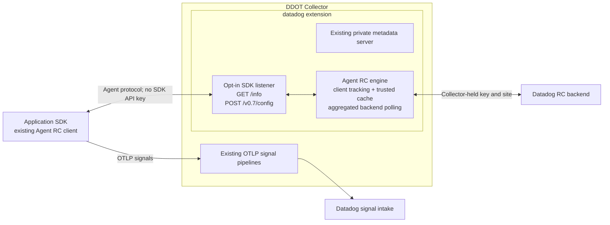

# Datadog extension: optional Remote Configuration

Development prototype for DDOT. Adds an opt-in `remote_config` capability to the existing contrib **Datadog extension**, without another customer-facing extension type or a Datadog Agent process.

## Motivation

Customers routing OTLP signals through a Collector also need Remote Configuration (RC). The Datadog Agent already implements backend polling, targeting, client tracking and trusted caching. This component reuses that service directly inside DDOT, so it can run without a companion Datadog Agent process.

SDKs use the existing Agent RC protocol. The Collector holds the API key, caches configuration and aggregates backend polling; SDKs decode and apply their configuration. Java can retain its existing RC client without introducing libdatadog or a separate agentless RC implementation. Supported endpoint selection and full backend qualification remain shipping requirements.

## Architecture



The SDK listener is separate from the metadata server. With RC disabled, the factory returns the original upstream extension instance. With RC enabled, a wrapper delegates metadata snapshots, pipeline/status notifications and serializer access, and owns the RC listener/service lifecycle. Startup rolls back metadata services if RC cannot start.

The internal service links the Agent RC Go packages directly. It retains targeting, trusted caching, signature/expiry handling and rate-limited cold-client refreshes. No RC algorithms are copied into the extension and no Datadog Agent daemon or IPC connection is required.

## Configuration

Requires this custom DDOT build. This block is **not supported by the stock OSS extension**.

```yaml
extensions:
  datadog:
    api:
      key: ${env:DD_API_KEY}
      site: ${env:DD_SITE}
    remote_config:
      enabled: true
      endpoint: 127.0.0.1:8234
      cache_directory: /var/lib/datadog/remote-config

receivers: ...
processors: ...
exporters: ...
service:
  extensions: [datadog, ...]
  pipelines: ...
```

| Setting | Prototype behavior |
| --- | --- |
| `remote_config.enabled` | Defaults to false. No RC listener, cache or poller when disabled. |
| `endpoint` | Defaults to `127.0.0.1:8234`; only `/info` and `/v0.7/config` are served. |
| `cache_directory` | Required absolute writable directory when enabled. Instances use separate private subdirectories. |
| `refresh_interval` | Defaults to one minute. SDK polls remain separate; cold clients can trigger bounded cache-bypass refreshes. |
| `request_timeout` | Defaults to five seconds; the HTTP boundary returns 503 on timeout even if an engine wait ignores cancellation. Backend requests have ten-second deadlines and shutdown cancellation. |
| Listener TLS/authentication | Standard Collector HTTP server settings inside `remote_config`. Configure for remote workloads. |

Only top-level `api.key` and `api.site` supply RC credentials; a second `remote_config.api` block is rejected. The wrapper builds an isolated Agent config adapter from those resolved values, so unrelated Agent environment credentials do not override them. Upstream keeps its own adapter private: sharing the actual adapter and live key rotation requires an upstream service hook. This prototype reloads credentials by component restart.

Backend requests use Collector HTTP client settings for verified TLS, custom trust roots, client certificates, proxies and connection limits, while retaining Agent RC request serialization. Redirects are disabled, and the instrumented transport preserves connection-pool cleanup. Custom outgoing auth, headers, middleware and compression are rejected to keep API-key authentication and transport ownership explicit. RC rejects insecure TLS.

Loopback works only in a shared network namespace. Separate pods need a reachable node-local listener, TLS trust and workload access controls. Do not expose the metadata server to SDK workloads. DDOT's separate `ddflare` extension is unchanged.

## Standalone DDOT

Build the normal DDOT binary with `dda inv otel-agent.build`, then run it without a core Agent:

```sh
DD_OTELCOLLECTOR_ENABLED=true DD_OTEL_STANDALONE=true \
  ./bin/otel-agent/otel-agent run --config=file:/path/to/collector.yaml
```

The Collector resolves the API key from its own configuration. SDKs do not receive that key. The standalone command owns logging, the RC listener and the local cache; it does not require an Agent configuration-sync connection.

## SDK boundaries

- **Java:** use its existing Agent RC client. The released Java 1.68.1 protocol test exercises the HTTP adapter without an SDK key. Supported endpoint configuration, targeting and application/removal of live backend configuration need end-to-end qualification.
- **Python and Node.js:** qualify their Agent RC transport alongside OTLP export. Existing agentless clients are not a dependency of this design.
- **DI is separate:** RC can deliver probe configuration, but this component does not expose snapshot, diagnostic or symbol upload routes. Those product signals need a separate design and qualification.

The listener serves Agent JSON `/v0.7/config`. SDK transport selection must match that protocol.

## Collector integration

The SDK listener uses standard Collector HTTP server TLS/authentication and reports fatal serving errors through component status. Backend HTTP activity uses the Collector tracer/meter providers. The Agent service's cache-bypass rate-limit and timeout counters, together with its subscription instruments, use the Collector meter provider under `datadog.remote_config.*`.

## Validation and remaining work

Tests cover opt-in behavior, shared resolved credentials, config decoding, listener separation, metadata capability delegation, startup rollback, shutdown, Agent JSON fidelity, client identity normalization, request limits, error redaction and cancellation of a stalled real Agent RC service. Backend tests verify custom CA trust, a single Collector API key, redirect rejection and connection-pool cleanup through OTel instrumentation. Metrics tests verify the Agent service instruments reach the Collector meter provider.

Before shipping:

1. Validate two independently targeted SDK clients and measure shared backend polling, including cold starts and cache bypasses. Existing Agent engine tests exercise the reused engine; adapter tests alone do not establish multi-client load behavior.
2. Verify Java RC updates/removals against staging without an SDK API key or direct backend egress, while preserving OTLP signal export. Define public endpoint onboarding and Collector backend identity/entitlements.
3. Complete workload authentication qualification, credential rotation, cache ownership, bounded client admission and expiry/outage/restart tests. Node-local deployment or stable affinity avoids unnecessary replica churn.
4. Keep DI delivery separate; qualify its probe execution, diagnostics, symbols and product results before advertising DI support.
5. Update DDOT/OSS onboarding and Kube Stack injection. Start DDOT-first, then seek integration into existing contrib `datadogextension` after GA, with dependency extraction and maintainer review.

This draft retools the Agent RC service for the Collector extension lifecycle. DDOT is the initial delivery target; upstream integration remains subject to dependency extraction and maintainer review.
