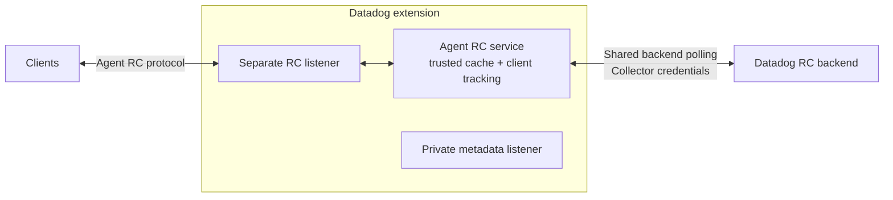

# Datadog extension: RC and SDK instrumentation telemetry

This prototype adds optional Remote Configuration (RC) and SDK instrumentation telemetry to the DDOT Datadog extension using the shared contrib adapter and Agent RC service. No separate Datadog Agent process is required.

## Design



The factory preserves the existing metadata lifecycle and owns a separate SDK listener and optional RC service. Top-level API-key/site settings supply backend authentication and routing. Collector HTTP settings, instrumentation and component status handle transport and lifecycle integration.

The shared Agent HTTP API only provides client injection. Redirect policy and connection cleanup belong to the extension.

## Configuration

The RC-capable factory is registered in DDOT builds from this branch. Enable it through the existing `datadog` extension; RC stays disabled unless `remote_config.enabled` is true.

```yaml
extensions:
  datadog:
    api:
      key: ${env:DD_API_KEY}
      site: ${env:DD_SITE}
    remote_config:
      enabled: true
      endpoint: 127.0.0.1:8234
      cache_directory: /var/lib/datadog/remote-config

receivers: ...
processors: ...
exporters: ...
service:
  extensions: [datadog, ...]
  pipelines: ...
```

RC defaults to disabled. The cache directory must be absolute and writable. Keep the metadata listener private; use listener TLS/authentication for access beyond the local host. Backend TLS verification is required, redirects are disabled, and credentials currently reload by component restart.

## Build and run for testing

```sh
dda inv otel-agent.build
DD_OTEL_STANDALONE=true DD_OTELCOLLECTOR_ENABLED=true ./bin/otel-agent/otel-agent run --config=file:/absolute/path/otel-config.yaml
```

Use an existing Collector configuration with the extension block above and a writable absolute cache directory. The normal DDOT binary and its packaging build include the factory; no custom factory registration is needed. Custom distributions can still use `NewFactory(upstream.NewFactory())`.

## Remaining work

- Preserve backend-controlled polling when no refresh interval is configured.
- Complete deployment, larger-scale and credential-rotation qualification.

The RC listener and Agent service adapter come from the public contrib `pkg/datadog/remoteconfig` module. This package retains distribution factory and lifecycle wiring. DI export is configured on the Datadog exporter and uses the independent contrib `pkg/datadog/di` module.

The draft uses an immutable fork replacement for the [upstream RC adapter experiment](https://github.com/open-telemetry/opentelemetry-collector-contrib/pull/53247). Replace it with an upstream module release before shipping. DDOT supplies the Agent-compatible build metadata required by the current RC backend.

## SDK instrumentation telemetry

Set `sdk_endpoint: 127.0.0.1:8234` and `instrumentation_telemetry.enabled: true` on the existing Datadog extension. This exposes the native SDK telemetry route beside RC. Each capability can be enabled independently; telemetry-only mode requires no RC cache. The forwarding implementation comes from the same contrib module as the upstream extension.

The forwarder preserves compressed request bodies, supplies Collector credentials and returns the intake status. It is bounded and synchronous, with no additional queue or retries. Use `sdk_http` for listener TLS/authentication settings. The existing private metadata listener remains separate.

Python is the core POC. Java parity follows once Python's complete flow is stable. Before shipping, agree standalone Collector backend identity and RC health reporting, publish the Agent RC API module and replace experimental module pins.
