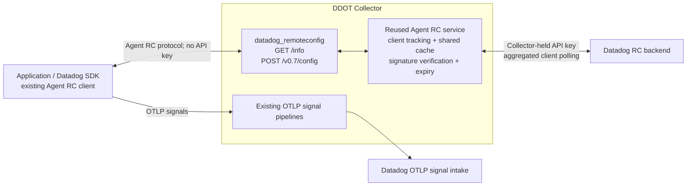

# Datadog Remote Configuration extension

Development prototype for DDOT. This extension lets Datadog SDKs receive Remote Configuration (RC) through a Collector using their existing **Agent RC clients**, without a Datadog Agent process or API keys in applications.

## Design



The extension wraps the [Agent RC service](../../../../../../pkg/config/remote/service), including its client registry, rate-limited refreshes, persistent trusted cache, targeting, signature verification and expiration handling. The service polls the backend on behalf of SDK clients. The HTTP adapter preserves the Agent JSON protocol and serves discovery for that endpoint. It does not translate Agent requests into per-SDK agentless requests.

The factory is registered in DDOT with development stability. It is activated only when configured in `service.extensions`. It does not require a separate core Agent, IPC server or trace intake. SDK OTLP signals continue through existing Collector pipelines.

## Configuration

Add this extension to an existing DDOT configuration:

```yaml
extensions:
  datadog_remoteconfig:
    endpoint: 127.0.0.1:8234
    api:
      key: ${env:DD_API_KEY}
      site: ${env:DD_SITE}
    cache_directory: /var/lib/datadog/remote-config

service:
  extensions: [datadog_remoteconfig]
```

| Setting | Behavior |
|---|---|
| `endpoint` | SDK-facing HTTP listener; defaults to `127.0.0.1:8234`. Only `/info` and `/v0.7/config` are served. |
| `api.key`, `api.site` | Collector-held backend credentials and routing. Site defaults to `datadoghq.com`. Reuse the same secret source as other Datadog Collector components. |
| `cache_directory` | Required absolute writable directory. Each extension instance has its own private subdirectory and Agent RC database. Mount persistent storage for restart continuity. |
| `refresh_interval` | Backend polling interval; defaults to one minute, matching the reused service's default. New clients can trigger rate-limited refreshes. This is separate from SDK polling. |
| `request_timeout` | SDK request context deadline; defaults to five seconds. Agent cache-miss handling has its own bounded wait. |
| HTTP server settings | Standard Collector HTTP listener settings, including TLS and authentication. Request bodies default to a 1 MiB limit. |

Loopback is suitable only when application and Collector share a network namespace. Kubernetes needs a reachable node-local listener, TLS/trust and workload access controls. Do not expose this configuration service publicly. Credential changes currently require restarting the extension. Signed configuration is returned to SDKs; backend keys are not.

## SDK compatibility and Java

This approach can unblock Java without implementing a new Java agentless RC client or integrating libdatadog, which Java cannot reuse. Java already has the Agent protocol client. Its existing URL override bypasses Agent discovery and can point at this extension:

```text
-Ddd.remote_config.url=http://127.0.0.1:8234/v0.7/config
```

This override is **internal**, according to the configuration registry. It is a POC mechanism, not a newly supported public onboarding contract. Shipping requires agreeing a supported endpoint setting/injection path, testing released DDOT Java versions and verifying actual configuration application. Keep OTLP export configured separately; this listener is not an Agent trace intake.

Source evidence: [Java endpoint selection](https://github.com/DataDog/dd-trace-java/blob/3a83ef40654eb5349e7e97d31dd4c13b58a484b0/communication/src/main/java/datadog/communication/ddagent/SharedCommunicationObjects.java#L167), [optional API-key header](https://github.com/DataDog/dd-trace-java/blob/3a83ef40654eb5349e7e97d31dd4c13b58a484b0/remote-config/remote-config-core/src/main/java/datadog/remoteconfig/PollerRequestFactory.java#L107). Python and JavaScript can likewise use their Agent clients, but this draft does not claim their Collector-mode qualification.

## Tradeoffs and remaining work

- Compared with HTTP Forwarder, this reuses Agent behavior and SDK protocols, centralizes authentication, and aggregates backend polling. It introduces RC state and a larger Agent dependency footprint into the Collector. Cache-bypass traffic still exists; capacity needs measurement.
- This is **RC service reuse**, not full Agent parity or GA readiness. Live-backend validation, Kubernetes defaults, key rotation, host/resource enrichment, RC-specific metrics/status, backend identification of Collector clients, product controls and lifecycle/load testing remain required. DI output delivery is a separate project.
- The prototype uses the Agent RC transport/configuration and built-in trust roots. It does not expose backend URL or trust overrides through extension YAML. Backend requests have a ten-second deadline and are canceled on shutdown. Review inherited redirect behavior and complete lifecycle/load qualification before GA.
- Ship and validate in DDOT first. **After GA**, propose upstreaming to `opentelemetry-collector-contrib`, with maintainers and a dependency-extraction plan similar to the [Datadog Connector](https://github.com/open-telemetry/opentelemetry-collector-contrib/tree/main/connector/datadogconnector). Upstream acceptance is a future review, not assumed.

## Validation

The adapter tests cover Agent JSON payload fidelity, discovery, request rejection, error redaction and startup/shutdown. They use a fake RC service; signature validation, targeting and cache behavior remain the reused Agent service's responsibility and need integrated qualification.

`TestJavaAgentProtocol` optionally starts an unmodified released Java SDK against the HTTP adapter. Set `DDOT_RC_JAVA_AGENT` to a locally downloaded `dd-java-agent.jar` and `JAVA_HOME` to a JDK installation, and pass both into the Bazel test environment. It checks protocol compatibility without application API keys, not backend configuration delivery or product activation.
