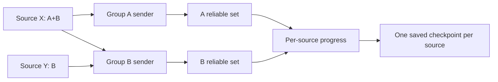

# Injected log routing: expected behavior

The PR adds an HTTP routing mechanism. Agent startup does not enable it; a caller supplies groups and selects them for each record.

| Selection | Result |
| --- | --- |
| A only or B only | Only the selected group receives the record. No fallback. |
| A+B | Both groups must finish. B may finish while A remains pending. |
| Excluded | Intentional local exclusion completes the record. |
| Empty or invalid | Holds a checkpointed source barrier; no recipient is inferred. |

**Queue acceptance is not delivery.** A selected group completes on its sender's terminal reliable outcome. Retryable failures, credential waits, and cancellation leave it pending. Existing permanent HTTP rejection and local processing-loss policies remain terminal.

## Reliable endpoint sets

| Path | Set and required outcome |
| --- | --- |
| Default | One sender and endpoint set for all logs. Main is reliable; extras are reliable by default or configured unreliable. Any one reliable endpoint's terminal outcome suffices. |
| Routed | One sender and endpoint set **per group**. Each group requires a reliable HTTP primary; extras may be reliable or unreliable. Every selected group must finish, but any one reliable endpoint within a group suffices. |

An endpoint does not have its own set. To require delivery to A **and** B, define and select separate groups. The routed definition enforces a reliable primary, **not** one reliable endpoint per group. Unreliable extras cannot complete a group. A declared `Group.Stream` shares batching and compressed bytes for identical selections; selecting only some of its groups is invalid.

## Checkpoints and outages

| Case | Result |
| --- | --- |
| Same source, disjoint records | An earlier pending A-only record holds a later completed B-only record's checkpoint. |
| Different sources | Each checkpoint advances independently until aggregate capacity fills. |
| X selects A+B; A down, B healthy | B receives X, but X's checkpoint waits for A. At 64 pending X records, X pauses. |
| Y selects B | Y continues and advances its checkpoint while X is paused. |
| A recovers | A's terminal outcomes release X's completed prefix; X resumes automatically. |
| Restart | B may receive duplicates. Replay needs retained input and an older saved checkpoint; without one, existing end-mode behavior may skip data. |

## Limits and lifecycle

| Area | Rule |
| --- | --- |
| Admission | 64 pending records per source; 4096 records and 4096 source owners/history entries in aggregate. Aggregate exhaustion may pause Y too. Selected group copies are not dropped on overflow. |
| Configuration | `logs_config.routing.max_groups` defaults to 4. At most 32 endpoints, 16 processing lanes, and 64 concurrent HTTP requests. No routing policy; MRF disabled. |
| Queues | Producer input: one queued plus one registering. Ingress/processed: 256 references each; source dispatch: 64; stream: 128 records/4 payloads; group: 32 dispatch/128 completion payloads; destination: `payload_channel_size` clamped to 1–128. These are reference limits, not a byte ceiling. |
| Caller | Use `SourceInput` per producer, `GuardRegistry` for direct checkpoint writes, and `RetireSource` after output admission. Start the auditor before the provider. |
| Replacement | Keep ownership after queue drain; reject obsolete generations. Retire only after pending records finish; history is bounded and released after all generations retire. |
| Shutdown | `Flush` reaches batches, not HTTP completion, and respects cancellation. `Stop` gives accepted work five seconds, then cancels blocked workers without acknowledging unfinished groups. |

There is no durable spool, per-endpoint saved checkpoint, or exactly-once guarantee.
