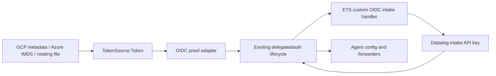

# OIDC workload identity prototype

Use the Agent's existing delegated authentication lifecycle with a generic JWT
token source. Azure, GCP, Kubernetes, and third-party JWT issuers all use the ETS
**custom OIDC** handler. No static Datadog API key is needed in Agent config.

This is a hackathon prototype. Live cloud and staging validation is still required.
Issuer registration, JWKS hosting/discovery, and intake mappings are prerequisites;
this change does not provision them.

## Interface and ownership



The provider boundary is one method:

```go
type TokenSource interface {
    Token(ctx context.Context, audience string) (string, error)
}
```

`comp/core/delegatedauth/api/cloudauth/oidc` owns this interface, the built-in
sources, and the proof adapter. `oidc.New` accepts an external implementation.
`common.Provider` remains the Agent boundary; existing AWS behavior stays on its
own provider. ETS transport, retries, API key refresh, status, and config writeback
remain in the existing delegatedauth component. A separate client library is not
needed to demonstrate this; extracting one can follow if non-Agent consumers need it.

Sources acquire tokens; they do not exchange them or discover JWKS. ETS verifies
signatures, issuer, audience, expiration, and the registered identity mapping.
The Agent performs only size and compact-JWT shape checks. It obtains a token on
every exchange attempt and does not cache workload tokens. The API key refresh
interval is independent of the lifetime of the workload JWT used to obtain it.

## Destination organization

The token proves workload identity. The configured `org_uuid` selects the Datadog
organization whose issuer, audience, and identity mappings ETS must check. Every
source sends that destination alongside the token by default; the token does not
need to contain a Datadog org ID. On the wire this uses the existing delegated-auth
suffix convention: `Authorization: Delegated oidc-<JWT>:<ORG_UUID>`.

New custom OIDC intake registrations opt into `org_uuid_source: request` and must
allowlist a nonempty audience intended for this exchange. ETS checks the signature,
issuer, audience, expiry, and an identity mapping in the requested org. Supplying an
org ID grants no permission. Any signed `dd_org_uuid` or `datadog/<org>` audience
must agree with the requested org. A token with no org restriction may be used in
multiple orgs only if each org independently trusts and authorizes it; caches remain
scoped by token and org.

Existing registrations retain their claim/audience requirements. The new ETS intake
handler accepts an explicit destination for them only when those requirements still
hold. For an older ETS deployment, set `oidc.org_uuid_source: claims` in Agent config
to omit the destination from the proof; the token must then carry the org itself.
Custom OIDC user/persona exchanges are unchanged. Deploy the backend support before
using the Agent's new default.

## Customer configuration

Use `site: datad0g.com` for staging. Replace `ORG_UUID` with the staging org UUID.
These examples assume a registered custom OIDC provider and an intake mapping
that explicitly permits the workload identity.

### GCP VM or GKE metadata identity

```yaml
site: datad0g.com
delegated_auth:
  org_uuid: ORG_UUID
  provider: oidc
  oidc:
    source: gcp
```

The source requests an ID token for `datadog/ORG_UUID` from the default attached
service account. Register `https://accounts.google.com` as the issuer, select
`org_uuid_source: request` on the **ETS registration**, and allowlist that exact
audience. Prefer the stable `sub` claim for the identity mapping.

### Azure VM managed identity

```yaml
site: datad0g.com
delegated_auth:
  org_uuid: ORG_UUID
  provider: oidc
  oidc:
    source: azure
    audience: api://YOUR_ENTRA_APP_ID
    # client_id: USER_ASSIGNED_MANAGED_IDENTITY_CLIENT_ID
```

The source uses Azure IMDS. `audience` is the resource URI accepted by Entra for
an application dedicated to this exchange. The optional `client_id` selects a
user-assigned identity; otherwise IMDS chooses the system-assigned identity.
This built-in source targets VM IMDS, not every Azure managed-identity environment
(App Service, AKS federated credentials, and others can supply a token file).

Register the token's exact issuer, its actual signed audience (which can differ
from the resource URI), `identity_claim_name: oid`, and `org_uuid_source: request`
on the ETS provider. Azure uses the same destination-org mechanism as every other
source; no Azure-specific routing setting is needed in the Agent.

### Kubernetes or an arbitrary provider writing a token file

```yaml
site: datad0g.com
delegated_auth:
  org_uuid: ORG_UUID
  provider: oidc
  oidc:
    source: file
    token_file: /var/run/datadog-identity/token
```

Add a dedicated projection to the existing Agent Pod/DaemonSet specification:

```yaml
spec:
  template:
    spec:
      volumes:
        - name: datadog-identity
          projected:
            sources:
              - serviceAccountToken:
                  path: token
                  audience: datadog/ORG_UUID
                  expirationSeconds: 3600
      containers:
        - name: agent
          volumeMounts:
            - name: datadog-identity
              mountPath: /var/run/datadog-identity
              readOnly: true
```

Merge this snippet with the deployment's existing volumes and mounts. Mount the
directory, not a `subPath`, so kubelet rotation is visible. The file must be
readable by the Agent's user. Register the cluster's exact service-account issuer,
`org_uuid_source: request`, and audience `datadog/ORG_UUID`. Map the exact `sub`, such
as `system:serviceaccount:oidc-hackathon:datadog-agent`. Its JWKS must be reachable
by ETS. Do not use the default token intended for the Kubernetes API server.

All settings support their normal `DD_` environment equivalents, for example
`DD_DELEGATED_AUTH_PROVIDER=oidc`, `DD_DELEGATED_AUTH_ORG_UUID=...`, and
`DD_DELEGATED_AUTH_OIDC_TOKEN_FILE=/var/run/datadog-identity/token`.

The existing per-product org settings and `DELA[ORG_UUID, oidc]` additional
endpoint directives reuse the global token source. A file cannot mint different
audiences for different orgs: supply an appropriately registered fixed audience
when sharing a file across independently authorized orgs, or use separate
Agent instances/token projections. GCP can request a distinct default audience
on each instance's exchange.

## Third-party onboarding

The no-rebuild integration is a token producer managed outside the Agent:

1. Register the issuer, accepted audiences, and allowed identity in Datadog.
2. Write a compact signed JWT to an Agent-readable local file. Never write a
   JSON envelope, a `Bearer` prefix, an ETS proof, or a Datadog API key there.
3. Refresh before expiration, write a temporary file with restrictive permissions,
   and atomically rename it over the token path. Keep the directory controlled by
   the credential producer. Token files and their contents must not go into flares.
4. Configure the file source above. The Agent rereads it on each exchange.

For a built-in source, implement `TokenSource`, add its typed configuration and
constructor in `FromConfig`, and add protocol tests. There is no dynamic Go plugin
loading, shell execution, or provider-specific ETS exchange implementation.
Implementations must support cancellation and concurrent calls and return errors
without tokens or raw provider response bodies.

The bundled metadata clients use fixed endpoints, a 10-second timeout, a 64-KiB
response limit, no proxy, and no redirects. ETS exchanges use Agent proxy/CA
settings but require HTTPS and refuse redirects for OIDC proofs.

## Staging validation plan

Use CAVM development/sandbox Azure and GCP accounts. Prefer a dedicated staging
Kubernetes namespace after confirming its issuer/JWKS is reachable by ETS. If it
is not, use a disposable cluster with a public issuer/JWKS endpoint; a local cluster
alone does not satisfy that prerequisite.

1. Connect commercial AppGate. Choose a staging org and record its UUID, the exact
   three workload identities, registered provider IDs, and dedicated audiences.
2. Run the backend unit suites and deploy the ETS + registration changes to an
   isolated Rapid test drive. Discover flags with `rapid test-drive create --help`.
   A test drive may require special routing; a local port-forward alone does not
   give cloud VMs a reachable HTTPS exchange endpoint. Confirm this before launch.
3. Build/package this Agent branch. On an Azure VM attach a managed identity; on a
   GCP VM attach a service account. Allow metadata access and HTTPS access to ETS.
4. Install the Agent on each VM and in the dedicated namespace using the examples,
   with no static `api_key`. Use `refresh_interval_mins: 1` for the demo, then
   restore the normal cadence. On a test-drive route use the existing configured
   HTTPS endpoint support; do not disable TLS verification.
5. Check Agent status for provider `oidc`, credential source `OIDC/gcp`,
   `OIDC/azure`, or `OIDC/file`, and successful key acquisition/refresh. Check ETS
   logs/audit metadata for **CustomOIDC**, including on Azure and GCP; successful
   native Azure/GCP handlers do not establish this prototype's acceptance criterion.
6. Emit a uniquely tagged DogStatsD metric from each workload and confirm it arrives
   in the chosen staging org. Record timestamps and tags, never JWTs or API keys.
7. Observe two API key refreshes. For Kubernetes, also wait for kubelet token
   rotation and confirm a later exchange succeeds without restarting the Agent.
8. In the dedicated test org, verify rejection for an unmapped identity, wrong
   audience, conflicting requested org, expired JWT, and invalid signature. A failed
   refresh should preserve the last API key while retries continue.
9. Delete test-drive deployments, test namespace/workloads, and temporary mappings;
   release or stop the CAVM resources under their normal lifecycle.

Local tests use a fake HTTPS ETS endpoint for client wiring and signed test JWTs
for backend validation. Neither is evidence of real cloud provisioning or successful
staging intake.

## Verification commands

From the Agent worktree:

```sh
bazel test //comp/core/delegatedauth/api/cloudauth/oidc:all \
  //comp/core/delegatedauth/api:all //comp/core/delegatedauth/impl:all \
  //pkg/config/setup:all --test_output=errors
```

From the companion dd-source worktree:

```sh
rapid test -s external-token-servicer --type unit \
  --filter 'TestCustomOIDCOrgHandlerSuite|TestClaimsSuite'
rapid test -s cloud-auth-config --type unit --filter TestCustomOIDCProviderOrgUUIDSource
```

Provider protocols: [GCP instance identity](https://docs.cloud.google.com/compute/docs/instances/verifying-instance-identity),
[Azure VM managed identity tokens](https://learn.microsoft.com/en-us/entra/identity/managed-identities-azure-resources/how-to-use-vm-token),
and [Kubernetes projected tokens](https://kubernetes.io/docs/concepts/storage/projected-volumes/).
